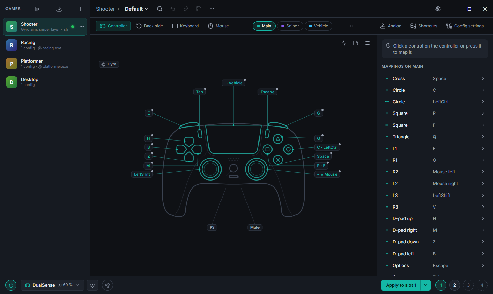
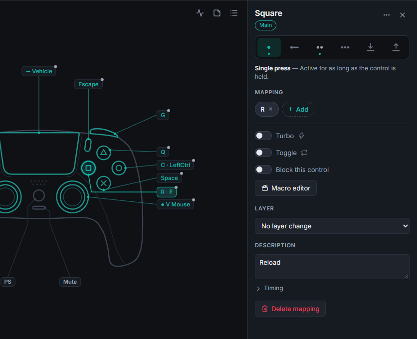
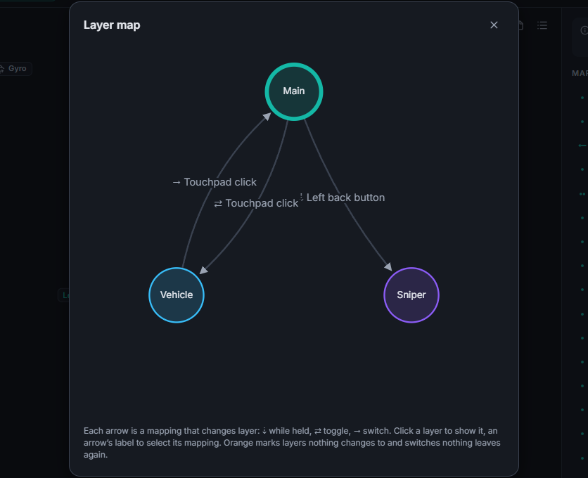
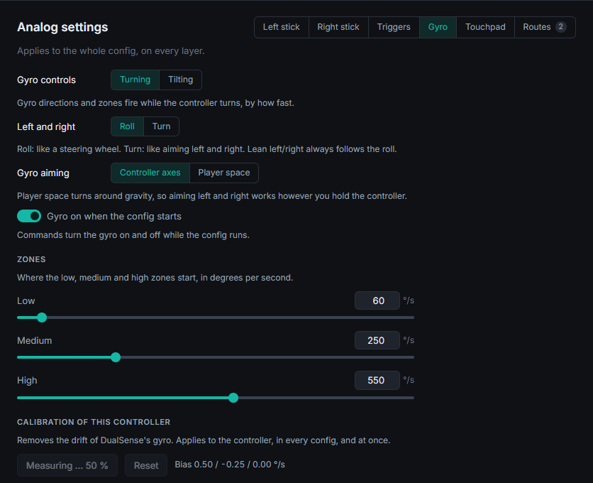
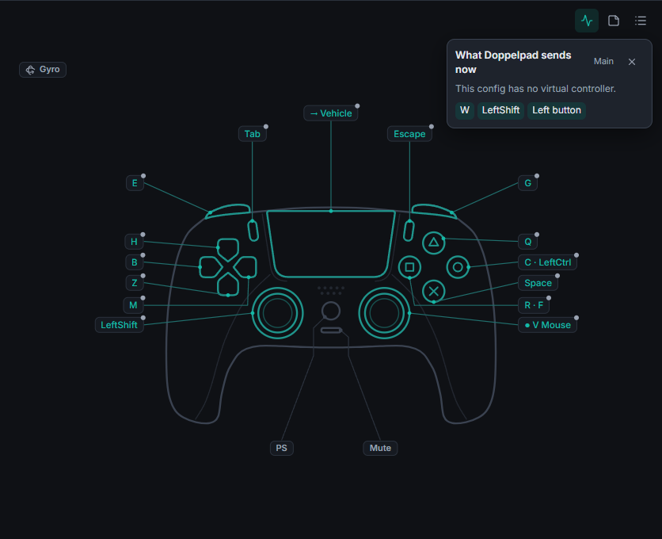

<p align="center">
  <picture>
    <source media="(prefers-color-scheme: dark)" srcset="site/src/assets/logo-dark.svg">
    
  </picture>
</p>

<p align="center">
  <strong>Free, open-source controller remapping for Windows, written in Rust.</strong><br>
  Linux in preview, macOS planned.
</p>

<p align="center">
  <a href="https://github.com/doppelpad/doppelpad/releases/latest"></a>
  <a href="https://github.com/doppelpad/doppelpad/actions/workflows/ci.yml"></a>
  <a href="#license"></a>
  
  
</p>

<p align="center">
  <a href="https://github.com/doppelpad/doppelpad/releases/latest"><strong>Download</strong></a> ·
  <a href="https://doppelpad.github.io/doppelpad/"><strong>Website</strong></a> ·
  <a href="docs/GUI.md"><strong>Desktop app guide</strong></a> ·
  <a href="docs/PROFILES.md"><strong>Profile reference</strong></a>
</p>

<p align="center">
  
</p>

Doppelpad turns any supported controller, keyboard or mouse into whatever a game expects:
remap buttons, build combos and macros, add shift layers, turbo, toggles, long/double/triple
presses, use your keyboard and mouse as an Xbox controller, aim with gyro, or drive the
desktop with a gamepad.

Doppelpad uses only open drivers ([ViGEmBus](https://github.com/nefarius/ViGEmBus) and
[HidHide](https://github.com/nefarius/HidHide)) and can import JSON profiles (schema 3.0)
from other remapping tools.

> **Status: preview, on the way to 1.0.** The features planned for 1.0 are implemented and
> unit-tested, and real DualSense input has been verified. What 1.0 still needs is mostly
> testing on real hardware and in games, above all of what Doppelpad sends to controllers
> (light bars, trigger effects, turning them off) and of the virtual DualShock 4. The Linux
> backend (evdev/uinput) passed a first test on a Steam Deck. What is left is listed under
> [Road to 1.0](docs/ROADMAP.md#road-to-10). Expect rough edges.

## Download

Get `Doppelpad_<version>_x64-setup.exe` from the
[latest release](https://github.com/doppelpad/doppelpad/releases/latest) and run it. It
installs ViGEmBus and HidHide when they are missing. The setup is not code-signed yet, so
Windows SmartScreen warns about it: choose *More info*, then *Run anyway*. Once installed,
Doppelpad offers new versions itself.

On Linux, take `Doppelpad_<version>_amd64.AppImage`, make it executable and start it; it
updates itself too. The command-line tool is in `doppelpad_<version>_linux-x86_64.tar.gz`.
Access to the input devices may need a udev rule (not on SteamOS): see
[docs/LINUX.md](docs/LINUX.md#install).

## Highlights

<table>
  <tr>
    <td width="50%" valign="top">
      
      <br><sub><strong>Map every control</strong>: six activators per control, turbo, toggles, macros and layer changes.</sub>
    </td>
    <td width="50%" valign="top">
      
      <br><sub><strong>Shift layers</strong>: hold, toggle or switch, and a map of how they connect.</sub>
    </td>
  </tr>
  <tr>
    <td width="50%" valign="top">
      
      <br><sub><strong>Gyro, sticks and triggers</strong>: deadzones, curves, zones, gyro aiming and calibration.</sub>
    </td>
    <td width="50%" valign="top">
      
      <br><sub><strong>See what is sent</strong>: the live view shows the keys, buttons and virtual controller right now.</sub>
    </td>
  </tr>
</table>

## Features

| | |
|---|---|
| **Inputs** | Xbox controllers (XInput), DualShock 4 and DualSense incl. gyro, touchpad and Edge paddles (USB/Bluetooth), Nintendo Switch Pro Controller, Joy-Con (paired automatically, or sideways on their own), Nintendo Switch Online and Switch-style wired pads incl. gyro (USB/Bluetooth), Switch 2 Pro Controller and GameCube controller (USB), GameCube controllers on the official USB adapter and clones in its Wii U mode (Windows), Steam Controller (USB and its wireless receiver) and Steam Deck incl. trackpads, gyro and back buttons (Windows), other HID gamepads and joysticks (identify their buttons once; Windows), keyboard, mouse buttons, wheel, mouse motion |
| **Outputs** | Virtual Xbox 360 or DualShock 4 controller, keyboard, mouse buttons/motion/wheel, controller rumble, a DSU (cemuhook) motion server for emulators |
| **Triggers** | Any button, stick direction, trigger pull/full pull, touchpad region, gyro direction, key, mouse button, wheel — alone or as combos of up to 4 |
| **Activators** | single, long press, double tap, triple tap, start (on press), release |
| **Modes** | hold, turbo (rapid fire), toggle, run-once macro, repeat N times, repeat while held |
| **Macros** | key/button/mouse/stick/trigger steps, pauses, wheel, rumble, launch program |
| **Layers** | shift layers (hold or toggle) with inheritance from the base layer |
| **Analog** | stick deadzones, anti-deadzone, response curves, rotation, inversion; stick → mouse, mouse → stick, gyro → mouse/stick, touchpad → mouse (with trackball glide) |
| **Profiles** | readable TOML, per-game auto-switching by foreground app, JSON profile import |
| **Safety** | hold Back + Start + LB + RB to stop every macro and release all outputs |

## Requirements (Windows)

- Windows 10/11 (x64)
- [ViGEmBus](https://github.com/nefarius/ViGEmBus/releases) — needed for virtual controllers
- [HidHide](https://github.com/nefarius/HidHide/releases) — optional, hides the physical controller so games don't see double input

The Windows setup installs both when they are missing (see
[docs/GUI.md](docs/GUI.md#installer)). Run `doppelpad doctor` to check both and list
detected controllers.

Switch 2 controllers connect over USB only for now. Doppelpad talks to their USB command
interface through WinUSB, which Windows normally sets up by itself. Only one program can
use it at a time. While Steam holds it, the controller works with default stick
calibration. Close Steam and Doppelpad takes the interface over within a few seconds,
without reconnecting the controller.

reWASD keeps controllers to itself while it runs. The app offers to quit it at start-up
(see [docs/GUI.md](docs/GUI.md#rewasd-running-at-start-up)).

## Build

```bash
cargo build --release
```

The binary is `target/release/doppelpad.exe`. Both the MSVC and the GNU toolchain work. With
`x86_64-pc-windows-gnu`, a full MinGW-w64 toolchain (for example WinLibs) must be on `PATH`,
because `windows-sys` needs `dlltool`/`as` to create import libraries and `windres` compiles
the version information of `doppelpad.exe`.

GitHub Actions (`.github/workflows/ci.yml`) checks every push to `main` and every pull
request: formatting, clippy and all tests on Windows (MSVC), the frontend's tests, types and
formatting, and on Linux the platform layer, the service and the platform-neutral tests.

## Desktop app

`doppelpad-gui` is a graphical editor and tray service. It has a game list, a controller,
keyboard and mouse view, shift layers, a binding panel with six activators, turbo/toggle,
shortcuts, a macro recorder, four config slots and per-game autodetect. Remapping keeps
running in the tray when the window is closed. The UI is in English and German.

```bash
cd gui && npm install && npx tauri build --no-bundle
target/release/doppelpad-gui.exe
```

See [docs/GUI.md](docs/GUI.md).

## Quick start

```bash
# Check drivers and controllers
doppelpad doctor

# Show live controller input (button names, stick values, gyro, touchpad)
doppelpad monitor

# Run a profile in the foreground (Ctrl+C restores everything)
doppelpad run profiles/examples/keyboard-mouse-to-xbox.toml

# Convert a JSON profile from another remapper
doppelpad import my-game.json -o my-game.toml

# Validate a profile
doppelpad check my-game.toml
```

### Background daemon and per-game profiles

```bash
# Profiles in %APPDATA%\doppelpad\profiles with `processes = ["game.exe"]`
# are applied automatically while that game has focus.
doppelpad daemon --profile profiles/examples/controller-desktop.toml

doppelpad status                      # profile, slots, remapping, auto-switch
doppelpad apply my-game.toml          # one-off profile
doppelpad apply my-game.toml --slot 2 # into slot 2 and activate it, like the app does
doppelpad select-slot 1
doppelpad clear-slot 2                # or: clear-slot all
doppelpad remap off                   # remap on brings the active slot back
doppelpad auto-switch off
doppelpad stop
doppelpad shutdown                    # the daemon; the desktop app is quit from its tray
```

The daemon shares its slots (`state.toml`), controller hotkeys (`hotkeys.toml`) and gyro
calibration (`calibration.toml`) with the desktop app. `doppelpad devices` lists controllers with ids that stay the same across
reconnects (on Linux the Bluetooth address or USB port; XInput pads on Windows are only
known by their XInput slot).

## Profiles

Profiles are TOML. A minimal one:

```toml
format = 1                        # version of the file format, not of Doppelpad
name = "My game"
processes = ["MyGame.exe"]

[[mappings]]
trigger = "A"                     # gamepad A / Cross
actions = [{ key = "Space" }]

[[mappings]]
trigger = ["LB", "RB"]            # combo
activator = "long"
mode = "once"
actions = [{ key = "Escape", action = "tap" }, { pause = 50 }, { pad = "Start" }]

[[analog]]
source = "right_stick"
target = "mouse"
sensitivity = 1.2
```

The full reference is in [docs/PROFILES.md](docs/PROFILES.md), and there are commented
examples in [`profiles/examples/`](profiles/examples).

## Platform support

| | Windows | Linux | macOS |
|---|---|---|---|
| Engine, profiles, CLI | ✅ | ✅ | ✅ (compiles) |
| Read controllers | ✅ XInput, raw HID (Sony, Nintendo) | ✅ evdev (incl. DualSense/Switch gyro + touchpad) | planned |
| Virtual controller | ✅ Xbox 360, DualShock 4 (ViGEmBus) | ✅ Xbox 360 (uinput) | — |
| Hide physical controller | ✅ HidHide | ✅ `EVIOCGRAB` | planned |
| Keyboard/mouse output | ✅ `SendInput` | ✅ uinput | planned |
| Keyboard/mouse capture | ✅ hooks | ✅ evdev grab + passthrough | planned |
| Per-game auto-switching | ✅ | ✅ X11 / XWayland | planned |

The Linux column was tested on a Steam Deck (SteamOS 3.8 and 3.9, desktop mode) with a
DualSense over USB and Bluetooth and a Switch Pro Controller over USB; DualShock 4, Joy-Cons
and Switch controllers over Bluetooth are untested. Linux setup (udev
rule for `/dev/uinput` and `/dev/input`, not needed on SteamOS) is in
[docs/LINUX.md](docs/LINUX.md), the hardware test checklist and its results in
[docs/LINUX-TESTING.md](docs/LINUX-TESTING.md).

Everything except `crates/dp-platform` is platform-independent. See
[docs/ARCHITECTURE.md](docs/ARCHITECTURE.md) and [docs/ROADMAP.md](docs/ROADMAP.md).

## Project layout

```text
crates/dp-core       input model, profile model, remapping engine (no OS code)
crates/dp-config     TOML loading/validation, JSON profile import
crates/dp-platform   OS backends behind traits (Windows: XInput, HID, ViGEm, HidHide, SendInput, hooks;
                     Linux: evdev, uinput, EVIOCGRAB, X11)
crates/dp-ipc        daemon control protocol (local socket, JSON lines)
crates/dp-service    remapping service shared by daemon and app (slots, auto-switch, live state)
crates/doppelpad      the `doppelpad` CLI / daemon
gui                  desktop app (Tauri 2 + Svelte), crate `dp-gui` in gui/src-tauri
docs                 architecture, profile reference, desktop app, roadmap, Linux setup and tests
profiles/examples    example profiles
```

## Contributing

Contributions are welcome. Do not submit code, assets or text taken from proprietary
software. Base changes on public documentation, open-source drivers and your own
observations.

## License

Licensed under either of [Apache License 2.0](LICENSE-APACHE) or [MIT](LICENSE-MIT) at your
option.

Doppelpad is an independent project. All trademarks belong to their respective owners.
